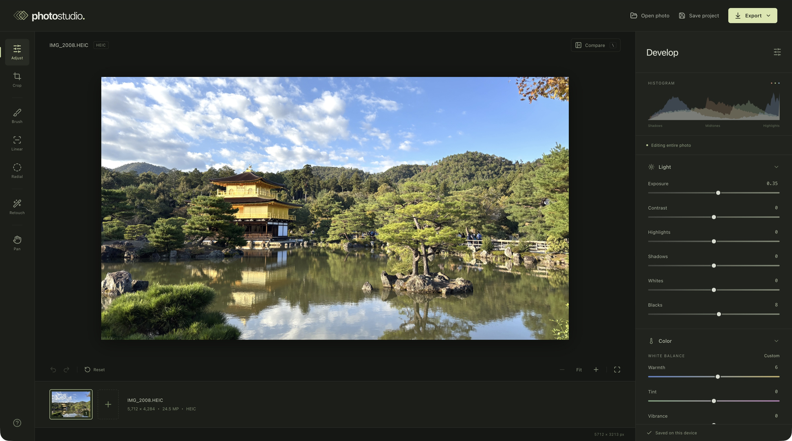

# Photo Studio

A local, non-destructive photo editor for JPEG, PNG, and HEIC. Built with React, TypeScript, and WebGL 2. Photos, masks, and edits stay in your browser; there is no backend, account system, analytics, or photo upload.



## Start

Use **Node.js 22.12+** and **pnpm 11**:

```sh
corepack enable
pnpm install
pnpm dev
```

Open **http://127.0.0.1:5173**. On this Mac you can also double-click `Start Photo Studio.command`. The launcher uses an installed Node/pnpm, or the existing Codex runtime when available. It does not install a system runtime.

```sh
pnpm build       # Type-check and create dist/
pnpm preview     # Serve the production build
pnpm test        # Geometry and project validation tests
pnpm test:e2e    # Browser and pixel-level rendering tests
```

Browser tests use installed Google Chrome locally. The optional CI workflow installs Playwright Chromium. To use Playwright's bundled browser locally, install it with `pnpm exec playwright install chromium` and run `CI=1 pnpm test:e2e` with the development server stopped.

## Tools

- **Crop:** freeform, original, square, portrait, widescreen, and custom aspect ratios. Move the crop or drag its corners. Rotate by 90°, flip, and straighten by up to 15°. Straightening scales to fill the frame. Geometry remains editable; masks stay anchored to the original photo.
- **Light:** exposure, contrast, highlights, shadows, whites, and blacks.
- **Color:** white-balance warmth and tint, saturation, vibrance, hue, and value. The eight-color mixer provides hue, saturation, and luminance changes by color range.
- **Detail:** sharpening amount and radius, plus vignette.
- **Masks:** soft brush with paint/erase, linear gradients, radial gradients, mask inversion, opacity, visibility, renaming, duplication, and ordering. Every mask has the same adjustment controls as the whole image. Up to 30 masks.
- **Retouch:** Heal automatically chooses nearby texture and adapts its color to the target boundary. Clone directly copies sampled texture. Option/Alt-click or use **Choose source** to select a source manually. Click or paint to repair; delete individual strokes in the retouch history.
- **Navigation:** fit view, up to 4× magnification relative to fit, space-drag panning, recenter, before/after comparison, and undo/redo (80 edit steps). A brush stroke or slider drag forms one undo step.

Double-click a slider label to reset that control. Numeric values are editable.

## Save and export

**Save project** downloads a `.photostudio` file containing the original photo bytes and all edit settings. Reopen it through **Open photo** or drag and drop. The original stays embedded as imported, including its original metadata. Projects are versioned and validated before loading.

The most recent photo and edits also save in this browser's IndexedDB. Reload and choose **Continue your last session**. Browser storage is not a backup: opening a different photo replaces the automatic draft, and clearing site data removes it. Save project files for anything you want to keep.

**Export** renders from the original-resolution photo, with JPEG quality controls or lossless PNG, at full cropped resolution or a smaller long edge. The renderer uses overlapping tiles so graphics texture limits do not force downscaled exports. PNG retains alpha; JPEG fills transparent areas with white. Exports omit source EXIF/location metadata and use the browser's standard sRGB canvas pipeline.

## Shortcuts

| Key                | Action                                      |
| ------------------ | ------------------------------------------- |
| V / C / B          | Adjust / Crop / Brush                       |
| L / R / H          | Linear gradient / Radial gradient / Retouch |
| Space + drag       | Pan                                         |
| O                  | Toggle mask overlay                         |
| `[` / `]`          | Smaller / larger brush                      |
| Option/Alt + click | Retouch sample source                       |
| Option/Alt + brush | Temporarily erase a brush mask              |
| `\`                | Toggle original comparison                  |
| ⌘/Ctrl + Z         | Undo                                        |
| ⇧ + ⌘/Ctrl + Z     | Redo                                        |
| ⌘/Ctrl + S         | Save editable project                       |
| ⌘/Ctrl + O         | Open photo or project                       |
| E                  | Export                                      |

## Verification

The implementation passes 5 unit tests and 20 browser integration tests, including HEIC decoding, EXIF rotation, mask coordinates after crop/rotation/zoom, healing and cloning, project recovery, transparent exports, and a 12-megapixel full-resolution export. Pixel tests compare tiled output across tile boundaries with the same image rendered in a single pass. A separate production-build smoke check verifies HEIC import and JPEG export with no external network requests.

An optional GitHub Actions workflow is saved in [docs/github-actions-ci.yml](docs/github-actions-ci.yml). To enable it, move it to `.github/workflows/ci.yml` and push using GitHub credentials with the `workflow` scope.

## Current scope

- Desktop Chrome/Edge with **WebGL 2 and graphics acceleration** is the primary target. The layout also adapts to narrow screens. Automated browser verification currently uses Chromium; Safari/Firefox have not been separately verified.
- Maximum import: **50 megapixels**, **20,000 pixels per side**, **200 MB**. Large exports and many large retouch strokes can take time and memory; browser/device canvas limits can be lower.
- Fit previews are reduced to 1800 pixels on the long edge; magnified previews increase to at most 4096. Full-resolution exports always use original pixels. Preview zoom is relative to fit, not a guaranteed one-source-pixel-per-display-pixel view.
- JPEG/PNG are decoded by the browser with orientation handling. HEIC tries native decoding, then lazy-loads `heic-to`/libheif locally. The fallback decodes one still image into 8-bit RGBA. Live Photo motion, depth maps, multi-image selection, HDR/gain maps, and preservation of wide-gamut profiles are not supported. Camera-specific HEIC variants can still fail; the UI reports decoding errors.
- Color controls are this application's own algorithms, not reproductions of Adobe's processing. Exposure operates in linear light; other artistic color operations work in sRGB. Intermediate WebGL passes use RGBA16F when available, otherwise RGBA8.
- Heal is a source-assisted texture/color blend, and Clone is manual sampling. These are suitable for small repairs; there is no generative object removal or AI subject selection.
- One photo is edited at a time. No catalog, batch processing, cloud sync, RAW development, or HEIC export yet.

## Architecture

```text
src/engine/model.ts       Versioned edits, defaults, geometry, project validation
src/engine/io.ts          JPEG/PNG/HEIC import, binary projects, local drafts
src/engine/shaders.ts     Exposure, color, per-color mixer, sharpening, vignette
src/engine/renderer.ts    WebGL passes, preview, tiled export, crop/rotation
src/engine/masks.ts       Brush/erase, linear and radial mask rasterization
src/engine/retouch.ts     Automatic source selection, healing, cloning
src/history.ts           Grouped undo/redo
src/components/          Canvas interactions and editor controls
tests/                   Model tests and browser/pixel integration tests
```

The pipeline is **decode → retouch → global adjustments → ordered local masks → crop/straighten/rotate → export**. The preview and export share the same shaders and edit graph. Local edits retain normalized source-image coordinates. Tiled exports use halos large enough for all sharpening passes.

For a future RAW phase, extend the decoder boundary in `io.ts`; camera color profiles, high-bit-depth working pixels, tone mapping, and exposure headroom will also need an explicit RAW processing path.

## Repository

[github.com/sidk2/photo-studio](https://github.com/sidk2/photo-studio)

The build is a static site. `base: './'` supports hosting under a repository path. Deploy `dist/` with a static host; no server-side photo processing is needed.

The README screenshot was captured from the editor in Chrome. No demo photo is bundled with the application. Synthetic test images are in `tests/fixtures/`.

## Dependencies

Required libraries are listed in `package.json`. Their licenses and source links are documented in [THIRD_PARTY_NOTICES.md](THIRD_PARTY_NOTICES.md), with decoder license text in `public/licenses/`.
